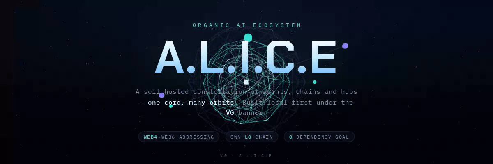
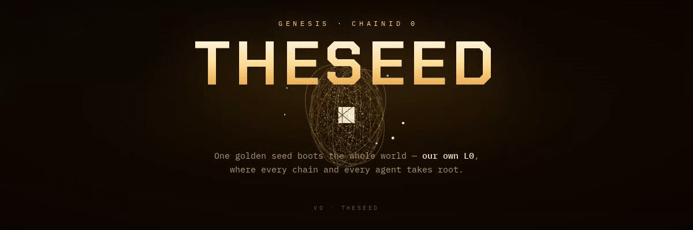
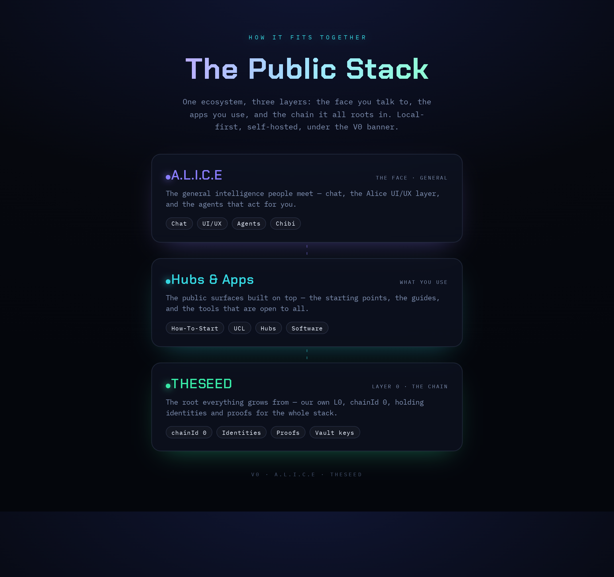

<!--
  V0 — GitHub profile README (repo: vzero911/vzero911 → README.md)
  Public-safe: no real name, no internal names, no local paths/ports/IPs,
  rounded figures only, no absolute claims. Art direction = the 3D artifacts:
  near-black 0b0d12, cyan 22d3ee, violet a78bfa, emerald 34d399, text c9d1d9.
  Hero: assets/alice_core.gif (animated 3D), still frame assets/alice_core.png.
-->

<p align="center">
  
</p>
<p align="center">
  <sub>A.L.I.C.E Core &nbsp;—&nbsp; built as a live three.js scene</sub>
</p>

<h1 align="center">V0</h1>

<p align="center">
  Building <b>A.L.I.C.E</b> — an organic, local-first AI that orchestrates its own stack,<br/>
  from agents and tools down to a Layer&nbsp;0 chain.
</p>

<p align="center"><i>Dream Higher, Assume Later.</i></p>

<p align="center">
  
  
  
  
</p>

<br/>

## Now

- **A.L.I.C.E** — the orchestrator: hundreds of MCP tools, norms and protocols that turn intent into coordinated agent work, with x402 payments in USDC on Base.
- **THESEED** — the proof layer: an own Layer&nbsp;0 chain plus Solidity contracts (Foundry + OpenZeppelin) carrying on-chain assets.
- **UCL** — the language: an AI-native, C++-inspired low level where tensors, weights and token streams are first-class types.

## The idea

One loop runs through everything: **A.L.I.C.E decides, the chain proves, the machine stays yours.**

```text
intent ──▶ A.L.I.C.E ──▶ agents · tools · norms ──▶ action
                 │
                 └──▶ THESEED (L0)  ──▶ proofs, assets, addressing
```

| Principle | What it means in practice |
|---|---|
| **Organic AI** | The AI is grown, not wired: norms and protocols shape behaviour; agents compose instead of being hard-coded. |
| **Own Layer 0** | Proofs live on a chain we control end to end — no rented consensus. |
| **web4 → web6 addressing** | Agents, humans and assets get addresses that outlive any single platform. Early, in progress. |
| **Zero-dependency goal** | Every external dependency is a liability; the long-term direction is to own the stack. A direction, not a claim. |
| **Local-first** | Runs on your hardware first. Cloud is an option, never a requirement. |

## Public work

| | Project | One line |
|:-:|---|---|
| ◈ | [**A.L.I.C.E**](https://github.com/vzero911/A.L.I.C.E) | Autonomous AI agent framework — MCP tools, norms & protocols, x402 / USDC on Base. Python. |
| ◈ | [**THESEED**](https://github.com/vzero911/THESEED) | Layer&nbsp;0 chain + smart contracts + on-chain game assets. Solidity · Foundry · TypeScript · three.js. |
| ◈ | [**UCL**](https://github.com/vzero911/UCL) | Unified Code Language — AI-native low-level language and its reference compiler (`.ucl`). |
| ◈ | [**How-To-Start**](https://github.com/vzero911/How-To-Start) | Plan-first notes on how V0 projects are designed and deployed. Read before you clone. |
| ◈ | [**42-Global**](https://github.com/vzero911/42-Global) | 42 school: C/C++ common core (libft, printf, push_swap, pipex, FdF, philosophers, CPP modules) under `old-common-core/`; ongoing work under `current-cursus/`. |

## Interactive 3D

Real three.js builds, not static renders — same dark art direction as this page (cyan / violet / emerald, Chakra Petch + IBM Plex Mono). Captured here as previews; built as live three.js scenes.

<table align="center">
  <tr>
    <td align="center" width="50%">
      <br/>
      <sub><b>A.L.I.C.E Core</b> — how intent fans out into agents, tools and norms.</sub>
    </td>
    <td align="center" width="50%">
      <br/>
      <sub><b>THESEED Layer Zero</b> — blocks, proofs and addressing as one structure.</sub>
    </td>
  </tr>
  <tr>
    <td align="center" colspan="2">
      <br/>
      <sub><b>The Public Stack</b> — how the public repos fit together, layer by layer.</sub>
    </td>
  </tr>
</table>

## Activity

<!-- Self-hosted: contribution snake generated by GitHub Actions (Platane/snk),
     published to this repo's `output` branch — no third-party render service. -->
<p align="center">
  
</p>

<!-- Self-hosted: metrics card generated by GitHub Actions (lowlighter/metrics),
     committed into this repo as assets/github-metrics.svg. -->
<p align="center">
  
</p>

<table align="center">
  <tr>
    <td align="center">
      
    </td>
    <td align="center">
      
    </td>
  </tr>
</table>

<p align="center"><sub>The snake and metrics card above are self-hosted (generated by GitHub Actions in this repo). The two cards in this row are still rendered by the external github-readme-stats service.</sub></p>

<p align="center">
  
  
  
  
  
  
  
  
  
</p>

## Reach

Issues and discussions on any repo above are the front door — [How-To-Start](https://github.com/vzero911/How-To-Start/issues) if you don't know where to begin.
Open to collaboration on agents, chains and languages that are meant to last.

<p align="center"><sub>Powered by A.L.I.C.E · built local-first</sub></p>
