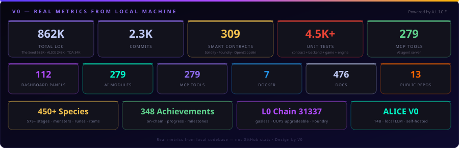
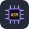

<!-- Header -->
<p align="center"></p>

<p align="center">
  
  
  
  
</p>
<!-- metrics widget — real project stats from local machine -->
<p align="center"></p>
<!-- /metrics -->

## 🧰 Tech stack

**Languages**

<p align="center">
  &nbsp;&nbsp;&nbsp;&nbsp;
</p>

**Web, mobile & 3D**

<p align="center">
  
</p>

**Blockchain, data & infra**

<p align="center">
  
</p>

<p align="center">
  
  
  
  
  
  
  
  
</p>


---

## 👋 About me

```python
class V0:
    school      = "42"
    roles       = ["Full-Stack Developer", "AI Developer", "Blockchain Developer", "Software Engineer"]
    learning    = ["Kernel", "DevOps", "Cybersecurity"]
    building    = ["🌱 The Seed — Web3 + AI game", "🔮 A.L.I.C.E — AI agent framework",
                   "🎮 TOA Infernal — dark fantasy game", "🤖 MCP + AGENTS — AI tooling"]
    powered_by  = "ALICE"
    style       = "ship clean, test twice, automate everything"
    remote      = True
    available   = True  # freelance missions & collaborations
    looking_for = ["3D artists", "2D artists / illustrators", "UI artists"]
```

---

## 🌱 Featured project — The Seed

<p align="center">
  <a href="https://github.com/VZero911/THESEED">
    
  </a>
</p>

<details>
<summary><b>🖼️ More screens</b> (the Village art is V2 and will be replaced)</summary>

<p align="center">
  
  
  
</p>
<p align="center"></p>

</details>

An evolving **Web3 + AI** environment, and its first use: a monster-collecting game where monsters, runes and items are
**tokenized assets** you truly own, on-chain. Your identity is a **wallet**; trades between players go through
**smart contracts** (escrow, auctions, on-chain royalties); every action is **signed for free** (gasless) and relayed by the game.

| Layer | What's inside |
|---|---|
| ⛓️ **Smart contracts** | Solidity · Foundry · OpenZeppelin UUPS — tokens, NFT monsters, on-chain **marketplace** (auctions, offers, escrow), polls, achievements · 261 contract test files, upgrade-safe |
| 🐍 **Backend** | Python · FastAPI · PostgreSQL · web3.py — SIWE login, encrypted wallet vaults, indexer, deterministic battle engine, 450+ species, 575+ stages, 272 backend test files |
| 🎮 **Game** | Expo · React Native (mobile + web) — summons, runes, dungeons, tower, world boss, guilds, marketplace (UI V2), 88 test files |
| 🖥️ **Admin console** | React · wagmi · **three.js** — live 3D view of the chain with wallets, block explorer, players, market, AI agents |
| 🤖 **AI** | automation registry, agent runs, MCP servers — the project is built to run itself |
| ✅ **Quality** | 4.5K+ unit test files, 18 browser walks on an isolated stack, security and licence scans, balance simulation |
| 📊 **Scale** | 585K LoC · 1.2K commits · 309 contracts |

<p align="center">
  <a href="https://github.com/VZero911/THESEED"></a>
</p>

### 🌍 Why it matters in real life: a concert ticket, with the code you can see above

The marketplace of the game is a small, tested version of how **any** asset could be traded
without a middleman. The same four steps, on a real example, a **concert ticket**:

| Step | In The Seed today | The same mechanism for a ticket |
|---|---|---|
| **1. Issue** | Only the `MintManager` contract mints a monster NFT, within a daily budget | The organizer mints exactly 5,000 tickets, nobody can add one |
| **2. List** | A player signs a fixed-price sale or an auction (reserve price, anti-sniping) | A fan lists the ticket at face value; the contract can cap the price |
| **3. Swap** | Escrow: the monster and the payment are locked together and swapped in one transaction | Money and ticket change hands at once: no scam, no "I paid but never got it" |
| **4. Share** | 2.5 % of each sale goes to the creator, shown *before* you sign | 5 % of every resale goes to the artist, forever, without a platform |
| **5. Prove** | Every sale is public on the chain, with its history | Provenance and authenticity of the ticket, checkable by anyone |

<p align="center">
  
  
  
</p>
<p align="center"><sub>The real screens: a sale, an offer received, the journal of every trade.</sub></p>

It is not a promise: the contracts are upgrade-tested, covered by invariant tests (no asset is ever
lost or created by a trade) and wait for an audit. **Real value needs audits and a legal frame
first.**

---

## 🔮 A.L.I.C.E — *Powered by Alice*

<p align="center">
  
  
  
</p>

**Autonomous Local Intelligence & Cybernetic Entity.**
An AI agent framework — monitoring, automation, chain sync, self-healing. Runs 100% local, zero cloud dependency.

| Metric | Value |
|---|---|
| Framework | Alice Framework Agi V0 |
| Dashboard | 106 React panels |
| AI modules | 36 active |
| MCP server | 36 tools for Agent / Cursor |
| Docker | 6 containers (Ollama LLM included) |
| Tools | 149 scripts |
| Lines of code | 132K |

<p align="center">
  <a href="https://github.com/VZero911/A.L.I.C.E"></a>
  <a href="https://github.com/VZero911/MCP"></a>
  <a href="https://github.com/VZero911/AGENTS"></a>
</p>

---

## 🎮 TOA — Infernal

<p align="center">
  
  
  
</p>

Dark fantasy game project — real-time backend, match coordination, event streaming.

<p align="center">
  <a href="https://github.com/VZero911/TOA-INFERNAL"></a>
</p>

---

## 🎨 Looking for artists

**The Seed** needs faces. I build the chain, the server and the game; I am looking for people to
give it a look worth the world behind it (dark magic, floating island, a giant scary tower):

- 🧊 **3D artists**: monsters, props, the Village island and its tower (glTF, low to mid poly, for three.js and mobile)
- 🖌️ **2D artists / illustrators**: monster art and skins, rune and item icons, banners, key art
- 🧩 **UI artists**: game screens on the V2 design tokens (gold frames, display font)
- 🎵 *Sound and music: not yet, later.*

Credit and a share of the project's contribution points (**POC**, earned, never bought) are on the
table; real money only after audits and a legal frame. See what exists in the
[showcase](https://github.com/VZero911/THESEED), then write me:
[vzero911@gmail.com](mailto:vzero911@gmail.com) or Discord **vzero911**.

<p align="center">
  
  
  
</p>

---

## 🔭 Right now

- 🔮 **A.L.I.C.E** — Alice Framework Agi, 36 modules, 106 panels, 132K LoC ([A.L.I.C.E](https://github.com/VZero911/A.L.I.C.E))
- 🌱 **The Seed** — 585K LoC, 309 contracts, marketplace V2, AI agents ([THESEED](https://github.com/VZero911/THESEED))
- 🤖 **MCP** — 36-tool AI agent server, x402 micropayments ([MCP](https://github.com/VZero911/MCP))
- 🤖 **AGENTS** — autonomous public node agents, zero deps ([AGENTS](https://github.com/VZero911/AGENTS))
- 🎮 **TOA Infernal** — dark fantasy game, 34.6K LoC ([TOA-INFERNAL](https://github.com/VZero911/TOA-INFERNAL))
- 🎓 **42** — C, C++, algorithms, systems ([42-Public](https://github.com/VZero911/42-Public))
- 📚 Learning **kernel**, **DevOps** and **cybersecurity**

---

## 📬 Let's build something

<p align="center">
  <a href="mailto:vzero911@gmail.com">
    
  </a>
  <a href="https://discord.com/users/vzero911">
    
  </a>
  <a href="https://github.com/vzero911">
    
  </a>
</p>

---

<p align="center"></p>
